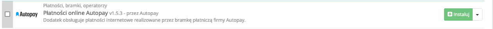
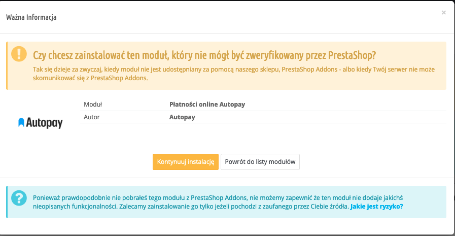
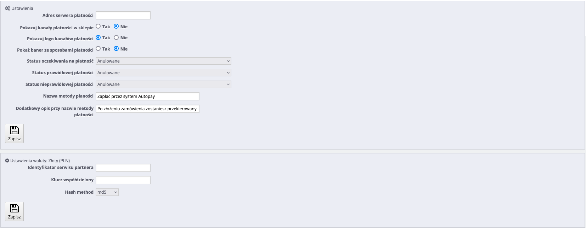

# Instrukcja dla modułu PrestaShop 1.6: "Płatności online Autopay"

## Podstawowe informacje
Autopay to moduł płatności umożliwiający realizację transakcji bezgotówkowych w sklepie opartym na platformie PrestaShop 1.6. 

**UWAGA!** Ze względu na zakończenie wsparcia dla PrestaShop 1.6 rekomendujemy aktualizację platformy sprzedażowej do wersji 1.7 oraz instalację modułu płatności z PrestaShop Addons. Wtyczkę PrestaShop 1.7 możesz pobrać [tutaj.](https://github.com/bluepayment-plugin/prestashop-plugin-1.7/archive/refs/heads/master.zip)

### Główne funkcje
Do najważniejszych funkcji modułu zalicza się:
- realizację płatności online poprzez odpowiednie zbudowanie startu transakcji
- obsługę powiadomień o statusie transakcji (notyfikacje XML)
- obsługę wielu sklepów jednocześnie z użyciem jednego modułu
- obsługę zakupów bez rejestracji w serwisie
- obsługę dwóch trybów działania – testowego i produkcyjnego (dla każdego z nich wymagane są osobne dane kont, po które zwróć się do nas)
- wybór banku po stronie sklepu i bezpośrednie przekierowanie do płatności w wybranym banku

### Wymagania
- Wersja PrestaShop: 1.4.5x - 1.6.1.11
- Wersja PHP zgodna z wymaganiami względem danej wersji sklepu

## Instalacja wtyczki

1. Pobierz najnowszą wersję wtyczki klikając [tutaj](https://github.com/bluepayment-plugin/prestashop-plugin-1.6/archive/refs/heads/master.zip).
2. Wejdź na http(s)://domena_sklepu.pl/nazwa_katalogu_administratora i zaloguj się do swojego konta administratora używając loginu i hasła.

3. Po zalogowaniu się przejdź do zakładki **Moduły > Moduły i usługi** i: 
- kliknij **Dodaj nowy moduł** (widoczny w prawym górnym rogu), by wgrać paczkę plików, którą pobrałeś w poprzednim kroku;

*(Po kliknięciu przycisku pojawi się okno umożliwiające wybór pliku z komputera.)*

● kliknij **Prześlij moduł**

Po wgraniu modułu – należy go zainstalować. Możesz to zrobić na dwa sposoby:
- odszukując go za pomocą wyszukiwarki;
- wybierając kategorię: **Płatności, bramki i operatorzy** i klikając **Instaluj**.

Na kolejnym ekranie, który ci się pokaże, musisz potwierdzić chęć instalacji modułu. Wystarczy, że klikniesz: **Kontynuuj instalację**. Gdy instalacje się zakończy, system przeniesie cię automatycznie do Konfiguracji modułu.

## Konfiguracja

### Konfiguracja sklepu

1. Zaloguj się za pomocą konta administratora na adres:
http(s)://domena_sklepu.pl/nazwa_katalogu_administratora 

2. Przejdź do zakładki **Preferencje ➝ SEO & URL**, znajdź **Przyjazny adres URL** i włącz klikając **Tak**.

3. Przejdź do zakładki Zamówienia > Statusy, aby dodać nowe lub edytować istniejące, tj.:

Żeby oznaczyć status oczekiwania na płatność:
- dodaj nowy status o przykładowej nazwie: Oczekiwanie na płatność
- zaznacz opcję: Zauważ czy zamówienie jest poprawne

Żeby oznaczyć status płatności jako prawidłowy:
- możesz użyć istniejącego, np.: Płatność zaakceptowana
- lub dodać nowy

Żeby oznaczyć status płatności jako nieprawidłowy:
- możesz użyć istniejącego, np.: Płatność niezaakceptowana
- lub dodać nowy

### Konfiguracja modułu

1. Przejdź do zakładki **Moduły ➝ Moduły i usługi** i wybierz z listy modułów kategorię: **Płatności, bramki, operatorzy** (lub wyszukaj moduł za pomocą wyszukiwarki).
2. Wybierz **Konfiguruj Płatności online BM** i uzupełnij wszystkie dane (otrzymasz je od nas). Jeżeli przycisk **Konfiguruj** nie jest widoczny – należy ponownie zainstalować moduł.
3. Żeby uzyskać od nas Identyfikator serwisu partnera oraz Klucz współdzielony – prześlij do nas adresy do komunikacji między sklepem a bramką płatniczą:
- http(s)://domena_sklepu.pl/module/bluepayment/back
- http(s)://domena_sklepu.pl/module/bluepayment/status

Opis pól:
1. Tryb testowy – zmiana trybu pracy bramki na testowy umożliwia weryfikację działania modułu bez konieczności rzeczywistego opłacania zamówienie (w trybie testowym nie pobierane są żadne opłaty za zamówienie).
2. Pokazuj kanały płatności w sklepie – po wybraniu płatności za pomocą Autopay prezentowane są możliwe kanały płatności (banki), dzięki czemu użytkownik może wybrać bank już na poziomie sklepu.
3. Pokazuj logo kanałów płatności – przy nazwach banków wyświetlane są ich logotypy.
4. Identyfikator serwisu partnera – składa się tylko z cyfr i jest inny dla każdego sklepu (uzyskasz go od Autopay).				
4. Klucz współdzielony – służy do weryfikacji komunikacji z bramką płatności. Zawiera cyfry i małe litery. Nie należy go udostępniać publicznie (uzyskasz go od Autopay).
5. Status oczekiwania na płatność – status zamówienia w sklepie – ustawiany natychmiast po rozpoczęciu płatności.		
6. Status prawidłowej odpowiedzi – status zamówienia w sklepie – ustawiany po potwierdzeniu płatności.				
7. Status nieprawidłowej płatności – status ustawiany w przypadku niepowodzenia płatności lub gdy płatności nie została zrealizowana przez dłuży czas (czas ten ustalamy dla każdego sklepu indywidualnie).			
8. Nazwa metody płatności – umożliwia zmianę nazwy metody płatności, prosimy o pozostawienie w tym miejscu słów „Autopay”.		
9. Dodatkowy opis przy nazwie metody płatności – wyświetlany przy nazwie płatności na stronach koszyka, pole możesz wykorzystać do wyjaśnienie zasady działania płatności z wykorzystaniem modułu Autopay.

Po uzupełnieniu wszystkich pól – kliknij **Zapisz**.

### Konfiguracja modułu Ship to Pay

💡Poniższa instrukcja jest przeznaczona dla sklepów, w których uruchomiono ten moduł.

Moduł Ship to Pay umożliwia przypisanie metody płatności do sposobu dostawy. 

1. Przejdź do zakładki **Moduły > Moduły i usługi** i wybierz z listy modułów kategorię: **Administracja** (lub wyszukaj moduł za pomocą wyszukiwarki).
2. Wybierz **Konfiguruj Ship to Pay** i zaznacz **Płatności online BM** przy sposobach dostawy, które wymagają zapłaty z góry.
3. Kliknij **Zapisz**, żeby potwierdzić wprowadzone zmiany.

## Zarządzanie kanałami płatności		

1. Zaloguj się za pomocą konta administratora na adres:
http(s)://domena_sklepu.pl/nazwa_katalogu_administratora 
2. Przejdź do zakładki **Administracja ➝ Autopay Zarządzanie kanałami płatności**
3. Żeby pobrać kanały płatności, kliknij **Aktualizuj kanały płatności** – po pobraniu powinna się pojawić lista kanałów płatności dla wybranego trybu pracy (testowy/produkcyjny). 

Jeżeli podczas pobierania pojawi się błąd – najprawdopodobniej podczas konfiguracji modułu zostały podane nieprawidłowe dane (Klucz współdzielony lub Identyfikator serwisu partnera)

💡 Panel umożliwia również dezaktywowanie/aktywowanie kanału płatności z poziomu sklepu. 

### Logi
					
W przypadku pojawienia się błędów podczas przetwarzania transakcji zapisywana jest odpowiednia informacja, która ma pomóc w szybszym odnalezieniu przyczyny problemu. 

Żeby przejrzeć logi – przejdź do zakładki **Zaawansowane > Logi** i uzupełnij następujące filtry:	
- Wiadomość BLUEPAYMENT 						
- Skala 3

### Powiadomienia mailowe
Jeżeli chcesz otrzymywać powiadomienia drogą mailową – przejdź do sekcji **Pliki log przez email** i ustaw minimalny poziom bezpieczeństwa na wartość 3. 

### Zamówienia

W podglądzie zamówienia, w sekcji **Zamówienie** dodawane są wpisy związane z informacjami na temat przebiegu procesu transakcji. 

### Transakcje i faktury

Tworzone są automatycznie w zależności od ustawień statusów transakcji. 

### Powiadomienia mailowe

Powiadomienia o zmianie statusu płatności wysyłane są w zależności od konfiguracji danego statusu. Jeżeli chcesz żeby powiadomienia były wysyłane – zaznacz opcję **Wyślij email do klienta, kiedy zmieni się status zamówienia** (wybrany musi być również odpowiedni szablon).

## Aktualizacja

1. Żeby dokonać aktualizacji – Wyłącz i Odinstaluj aktualnie używany moduł.

2. Następnie postępuj zgodnie z instrukcją opisaną w sekcji **Instalacja wtyczki**. 

## Odinstalowanie
Żeby odinstalować moduł – wybierz **Odinstaluj**, a następnie **Usuń**.

